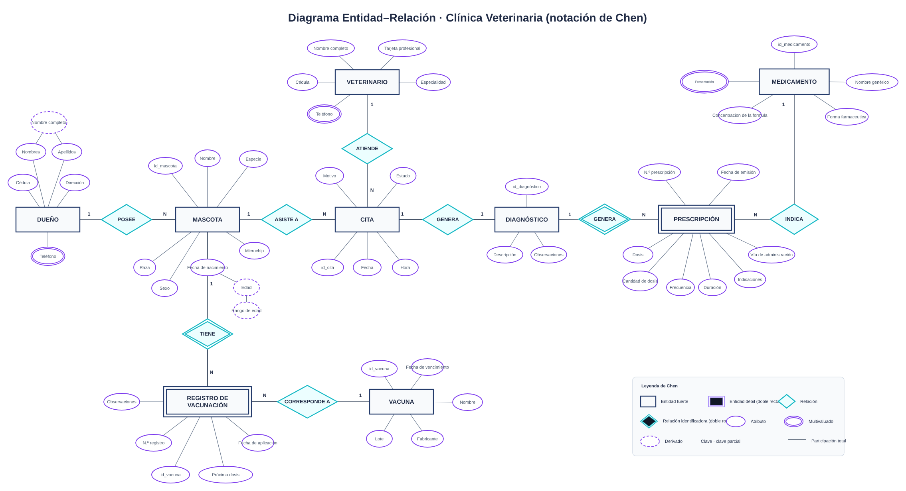
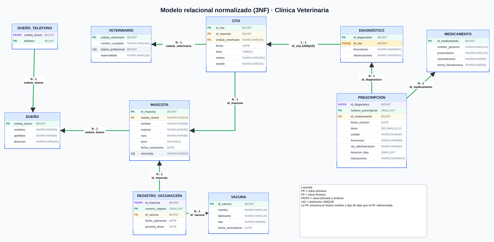
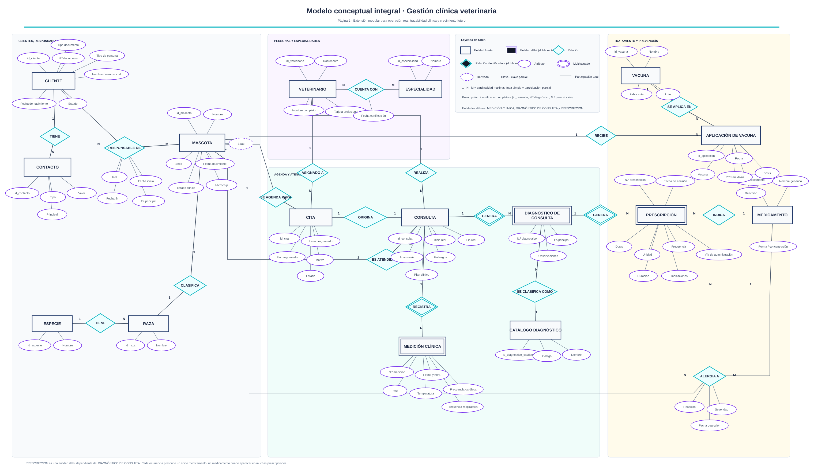
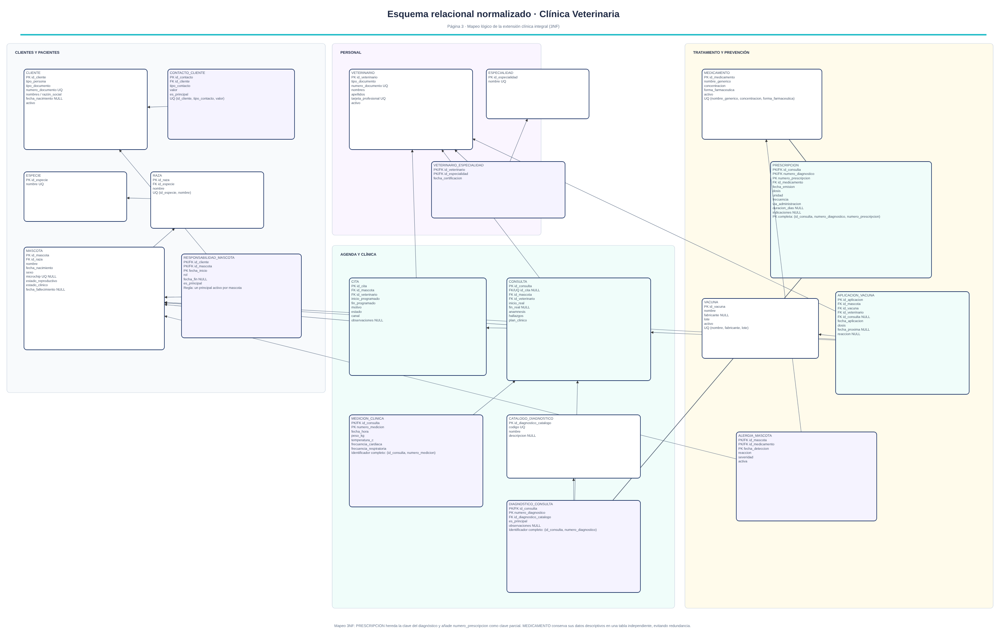

# Bases de datos relacionales en PostgreSQL

Diseño e implementación de una base de datos clínica para una veterinaria (modelo conceptual en notación de Chen → esquema lógico en 3FN → DDL en PostgreSQL con reglas de integridad), más un banco de consultas SQL sobre una base universitaria. Curso *Bases de Datos I* — Maestría en Ciencia de Datos, Universidad Santo Tomás (2026).

**Equipo:** Adrian Grateron · Harold Rodríguez · Jhonatan Smith Doncel

## 1. Clínica veterinaria

El modelo reconstruye la atención de una mascota de principio a fin:

```
DUEÑO → MASCOTA → CITA → DIAGNÓSTICO → PRESCRIPCIÓN → MEDICAMENTO
                MASCOTA → REGISTRO_VACUNACIÓN → VACUNA
```

### Diagrama entidad-relación (Chen)



### Modelo relacional en 3FN



<details>
<summary><b>Versión ampliada (propuesta conceptual, no implementada en el DDL)</b></summary>

El archivo de diagramas incluye una extensión modular para una operación clínica real: clientes con varios contactos, especies y razas, especialidades del veterinario, consultas separadas de las citas, mediciones clínicas, catálogo de diagnósticos y alergias. Es una propuesta de crecimiento; los scripts SQL de este repositorio implementan el modelo de 10 tablas mostrado arriba.





</details>

**Decisiones de diseño**

- 10 tablas en **Tercera Forma Normal**; teléfonos del dueño como atributo multivaluado en `dueno_telefono`.
- `prescripcion` y `registro_vacunacion` son **entidades débiles** con claves compuestas.
- Relación CITA–DIAGNÓSTICO 1:0..1 implementada con FK + `UNIQUE (id_cita)`.
- La edad de la mascota es un **atributo derivado**: no se almacena, se calcula desde `fecha_nacimiento`.
- Integridad con `PRIMARY KEY`, `FOREIGN KEY` (`RESTRICT`/`CASCADE` según el caso), `CHECK` de dominio, índices sobre FK y dos **triggers** PL/pgSQL:
  - impide registrar una vacuna aplicada después de su fecha de vencimiento;
  - impide emitir una prescripción con fecha anterior a la cita.

**Ejecución** (PostgreSQL 13+; probado en PostgreSQL 16):

```bash
psql -d tu_base -f sql/01_clinica_veterinaria_ddl.sql   # crea el esquema clinica_veterinaria
psql -d tu_base -f sql/02_datos_prueba.sql              # datos ficticios
psql -d tu_base -f sql/03_consultas_validacion.sql       # consultas + pruebas de integridad
```

El script 03 incluye cinco consultas analíticas (historia clínica completa, edad derivada, historial de vacunación, carga por veterinario, medicamentos más formulados) y cinco **pruebas negativas** que deben fallar: diagnóstico duplicado, vacuna vencida, prescripción anterior a la cita, borrado de un dueño con mascotas y valor de sexo fuera de dominio. Al ejecutarlo se obtienen cinco mensajes `OK`.

| Archivo | Contenido |
|---|---|
| `sql/01_clinica_veterinaria_ddl.sql` | DDL completo: tablas, restricciones, índices y triggers |
| `sql/02_datos_prueba.sql` | Datos de prueba ficticios |
| `sql/03_consultas_validacion.sql` | Consultas y pruebas de integridad |
| `docs/informe_clinica_veterinaria.pdf` | Documento final: reglas de negocio, normalización y justificación (se lee directo en GitHub) |
| `docs/*.png` | Diagramas en imagen: modelo implementado y versión ampliada |
| `Trabajo final/*.drawio` | Fuentes editables de todos los diagramas; se abren en [diagrams.net](https://app.diagrams.net) |
| `Trabajo final/Trabajo_Clinica_Veterinaria_PostgreSQL_Final.docx` | Documento final en Word (editable) |
| `Trabajo_Clinica_Veterinaria.docx` | Borrador previo del documento |
| `Informe final Bases de datos 1.pdf` | Informe de las consultas sobre la base universitaria |

**Limitaciones conocidas.** El documento establece que solo una cita *atendida* produce diagnóstico; el esquema garantiza como máximo un diagnóstico por cita, pero no valida el estado de la cita (podría añadirse un tercer trigger). Los `CHECK` con `CURRENT_DATE` se evalúan solo al insertar o actualizar.

## 2. Consultas sobre una base universitaria

`consultas_universidad.sql` resuelve 10 ejercicios de selección, filtrado, ordenamiento, agregación y uniones sobre las tablas `estudiantes`, `cursos`, `profesores` e `inscripciones`. El script de creación de esa base (`universidad_db.sql`) fue entregado por el curso y no se incluye aquí, por lo que las consultas requieren tener ese esquema cargado previamente.

## Tecnologías

PostgreSQL · PL/pgSQL · pgAdmin 4 · diagrams.net

## Licencia

El contenido de este repositorio (código, documentos y figuras propias) se publica bajo la licencia [Creative Commons Atribución 4.0 Internacional (CC BY 4.0)](https://creativecommons.org/licenses/by/4.0/deed.es): puede compartirse y adaptarse citando a los autores. Ver [`LICENSE`](LICENSE).
